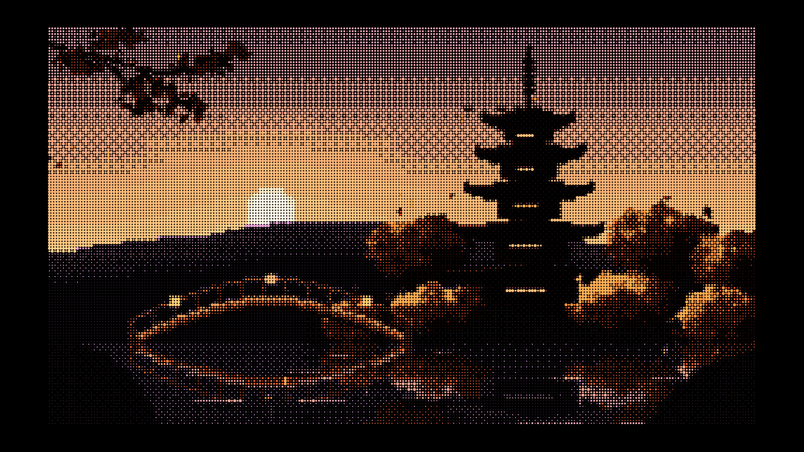
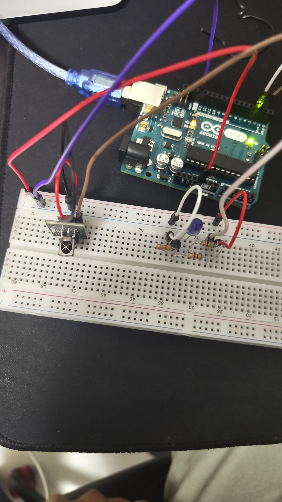

---

> 🌐 **Diller:** [🇬🇧 English](README.md) · **Türkçe** (bu dosya)

# TCL Android TV'nin Fabrika Katmanının Tam Haritası — ve Yazılımsal Root'un Neden İmkansız Olduğunun İspatı

> 8 gün, bir TCL 65T61C, bir Arduino Uno ve sökülen yüzlerce kapı.
> Bu depo bir "root rehberi" değil — **bir kapanış raporu**: cihazın fabrika/servis
> katmanı uçtan uca haritalandı, yazılımsal root'un bu firmware'de neden kuruluamayacağı
> kanıtlarla gösterildi ve başka araştırmacıların yolu paved etmek için her şey belgelendi.

**Kısa hikâye:** TV'nin içinde `tclfactoryos` adlı root daemon'u var ve içinde `system()`
çağrısına açık bir komut işlemcisi. Ona giden üç kanal vardı: IR, UART, p2p. IR protokolünü
baştan sona çözdük (56 kHz!), kernel sürücüsünü disassemble ettik ve öğrendik ki fabrika
dizisinin sabit baytları cihazın kendi tuş tablosunda hiç yok — **matematiksel olarak
hiçbir geçerli dizi gönderilemez.** UART fiziksel, p2p ise yalnız IR dizisinden doğuyor.
Yazılımsal yüzey: bitti. Bu depo, o yolculuğun tamamı.

---

## Cihaz

| | |
|---|---|
| Model | TCL 65T61C (65", Android TV 12) |
| Platform | Realtek RTD2875P / rtd6748 |
| Firmware | V8-R75PT01-LF1V618 (build STT2.230203.001 release-keys) |
| Kernel | 5.4.284+ · güvenlik yaması 2025-12-05 |
| Kumanda | RC833A dual-mode (Bluetooth HID + IR) |



*TV ile konuşan gerçek düzenek: Arduino Uno + 2N2222A sürücü + 940 nm IR LED —
çalışma anından fotoğraf. Bu devre TV'nin sesini tuş tuş açıp kapattı ve docs/04'teki
tüm fabrika problarını taşıdı.*

Araştırma bizzat sahibi olan cihaz üzerinde, yalnızca kendi ev ağı sınırları içinde
yapıldı. Cihazın içi hiç açılmadı; kalıcı yazma/anahtar yazımı hiç yapılmadı; çalışma
biter bitmez cihaz fabrika durumuna iade edildi.

## En değerli 5 bulgu

1. **IR protokolü: 56 kHz taşıyıcı** — kaynaklarda 38 kHz yazar, alıcı 56 kHz ister.
   Bütün erken denemelerin sessiz ölümünün sebebi buydu. Header 4000+4000 µs, 24 bit
   MSB-ilk `ADDR(4)|CMD(8)|~ADDR(4)|~CMD(8)`, bit 500 µs + 1000/2000 µs boşluk.
   40 tuşun tam kod tablosu: [`data/TCL-kumanda-kodlari.md`](data/TCL-kumanda-kodlari.md).
2. **Kernel IR sürücüsünün dili çözüldü** — frame'ler LSB-ilk biriktirilip baytlar
   bitrev8 ile çevrilerek 32-bit `w19` olur; tuş tablosu bu değerlerle eşleşir
   (VOL+ = `0x0b0f4f00` birebir doğrulandı). Fabrika tuşları `type-0x19` özel input
   olayıyla bildirilir ve **arg alanı tablodaki keycode'dan** gelir.
3. **İmkansızlık ispatı** — daemon'un RCU dizisi `0x01` ve `0x0C` sabit marker baytları
   ister; bu değerlerin tablodaki hane ailesine (`{b2,a3,f7,ac,81,58,92,ef}`) girmesi
   gerekir; girmiyor. **Hiçbir geçerli dizi kurulamaz.** Ayrıca tip-0x19 emisyonunu açan
   report-mode bayrağı root-only sysfs'te kilitli.
4. **p2p kanalının doğum gizemi** — daemon'daki reverse-connect thread'ini açılışta
   yaratan kod yok; yalnız geçerli IR commit'i doğurur. Yani **reboot da daemon-restart
   da p2p'yi getirmez** — "DB'ye IP yaz, reboot at" umudunu kanıtla öldüren bulgu.
5. **uid-1000 kod koşturma kapısı** — TCL'nin teşhis servisi üzerinden system_app
   olarak istenen jar'ı çalıştırma + 27856 fabrika socket'i (144B frame, whitelist'siz
   property DB). Root değil — ama root yüzeyine değen parmaklar.

## Kanıtlar

Her iddia log/getevent/disasm çıktısıyla doğrulandı; örnek kesitler:
[`data/kanit-ornekleri.md`](data/kanit-ornekleri.md) · ham IR ölçüm kaydı:
[`data/tus_kaydi_ham.log`](data/tus_kaydi_ham.log) · kernel tuş tablosu:
[`data/ir_table.bin`](data/ir_table.bin) (+ çözücü: [`tools/arduino/ir_tablo_parse.py`](tools/arduino/ir_tablo_parse.py)).

## Depoda ne var

```
docs/                            7 bölümlük tam dokümantasyon — Türkçe
docs/en/                          aynı yedi dokümanın tamamen İngilizce sürümü
tools/arduino/fabrika/           evrensel IR atıcı (fabrika.ino + atış scripti)
tools/arduino/{kumanda,tus_kaydet,ogren_gonder,ses_ac_oto}/   IR araç-zinciri sketch'leri
tools/arduino/rcu_hesap.py       RCU 13-hane + CRC16-CCITT-FALSE üreteci (not: kelime formatı eski — docs/04)
tools/factorysock.py             27856 fabrika socket istemcisi
tools/p2pclient.py               ts protokol istemci taslağı
data/                            tuş tablosu + kernel ir_table.bin + ham ölçüm + kanıt kesitleri
assets/                          kapak GIF + gerçek devre fotoğrafı + alıcı/TV bağlantı rehberi (PDF)
```

### Okuma sırası

1. [docs/01 — Keşif ve Erişim Kapıları](docs/01-kesif-ve-erisim-kapilari.md) — firmware damarı, uid-1000 kapısı, M-jar harness ailesi
2. [docs/02 — Daemon'un İç Haritası](docs/02-daemon-un-haritasi.md) — socket protokolü, FCMD, ts/p2p, root shell noktaları
3. [docs/03 — IR Savaşı: 38'den 56'ya](docs/03-ir-savasi-38den-56ye.md) — tüm ölümler ve kırılış
4. [docs/04 — Kök Fazı: Kernel Kanıtları](docs/04-kok-fazi-kernel-kanitlari.md) — w19, tip-0x19, imkansızlık ispatı, p2p doğumu
5. [docs/05 — Ölen Yollar Envanteri](docs/05-olen-yollar-envanteri.md) — 20+ kapatılmış vektör, gerekçeleriyle
6. [docs/06 — Dersler](docs/06-dersler.md) — teknik + metod + disiplin (14 ders)
7. [docs/07 — Araçlar ve Kullanım](docs/07-araclar-ve-kullanim.md) — her aracın tarifi

## ⚡ Hâlâ işe yarayabilecek, denenmemiş tek yol — fiziksel UART. Dene.

Yukarıdaki her şey yazılım kapılarının kapandığını kanıtlıyor. **Tam bir kanal hiç
denenmedi ve kapalı olduğuna dair hiç kanıt yok: fiziksel UART.** Bu TV'nin sahibi
aile cihazını açamadı — ama *sen* bu modelde ya da kardeşinde servis hattına
erişebiliyorsan, her parçası hazırlanmış, gerçekten umut verici bir yol:

1. **Hattı bul.** Daemon UART'ı HAL üzerinden okur (`/dev/ttyS0`). Arkada servis/RS232
   jakı ara (otel modeli TCL'lerde olur); yoksa test noktaları ana karttadır.
2. **Bedava köprüle.** USB-TTL gerekmez: **RESET→GND** yapınca Arduino Uno bir
   USB-seri köprüsü olur (seviyeye dikkat — TV'nin 3,3 V TX'ini Uno RX'e inen bölücüden geçir).
3. **Kanal uçtan uca haritalı.** `myuart → transfer_data → FCMD`
   ([docs/02 §3](docs/02-daemon-un-haritasi.md)) — aynı root komut işlemcisi, 56 baytlık
   `get_system_prop` enjeksiyon payload'u hazır bekliyor.
4. **Daemon'u reboot'suz kaldır** M-jar kapısıyla
   ([docs/07 §7](docs/07-araclar-ve-kullanim.md), `pmon`).

Denersen — başarı da başarımsızlık da — issue ya da PR aç; bu depo bulgularını taşır.

## Devam etmek isteyen için

- **Aynı serinin başka modeli elinizdeyse:** önce `factory_ro` bölmesinden `ir_table.bin`'i
  çekin ve 0xD ailesinde `0x01`/`0x0C` keycode'ları arayın — varsa IR-RCU dizisi o modelde
  **çalışabilir** (ispatımız bu firmware'in tablosuna özgü).
- **Donanım yolunda:** bazı TCL'lerde arkada harici servis/RS232 jakı olur; Arduino Uno'nun
  RESET→GND hilesi bedava USB-TTL köprüsüdür. Kanal açılırsa ilk atış hazırdır:
  `get_system_prop` key = `x;id>/sdcard/Download/R1.txt;id>/data/local/tmp/R2.txt;#`
  (56 bayt < 64 — docs/02).
- TCL 2020 public root'u (SICK-2020-012) bu firmware'de yamalıdır; genel kernel LPE'leri
  de (Aralık 2025 yaması) kapalıdır.

## Neden yayınlandı

Çünkü negatif sonuç + kanıt, katkıdır. Bu depo; yanlış frekansta günler harcayan birine
(56 kHz dersi), yanlış bacak sırası yüzünden çalışan sanılan devreye (C–B–E errata'sı),
"reboot at belki düzelir" umuduna (kanıtlı neden yaramaz) ve TCL'ın fabrika katmanını
merak eden herkese ait. Kardeş proje: [gt111a-ozgurlestirme](https://github.com/4onurdemir/gt111a-ozgurlestirme)
(kurtarılamayan bir kameranın kurtarma dersleri).

## Etik ve yasal

Sahibi olduğum tek cihazda, kendi ağım içinde yapıldı. Saldırı yok, kimse zarar görmedi,
cihaz çalışma sonunda fabrika durumuna döndürüldü (temizlik kaydı docs/06, ders 13).
Buradaki bilgi yalnızca savunma araştırması ve eğitim amaçlıdır.

## Atıf (zorunlu)

Bu depo işine yaradıysa, lisans tek küçük şey istiyor: projenin
katkıda bulunanlar/atıf bölümünde yazarı anman:

```text
Yazar:  4onurdemir
GitHub: https://github.com/4onurdemir
Web:    https://onurdemir.dev
```

Geri kalan her şey serbest — değiştir, dağıt, ticari işler çıkar,
kendi çalışmanı dilediğin lisansle yayınla.

## Lisans

[MIT + Atıf](LICENSE) — kullanım serbest, yukarıdaki atıf satırı ile birlikte.
